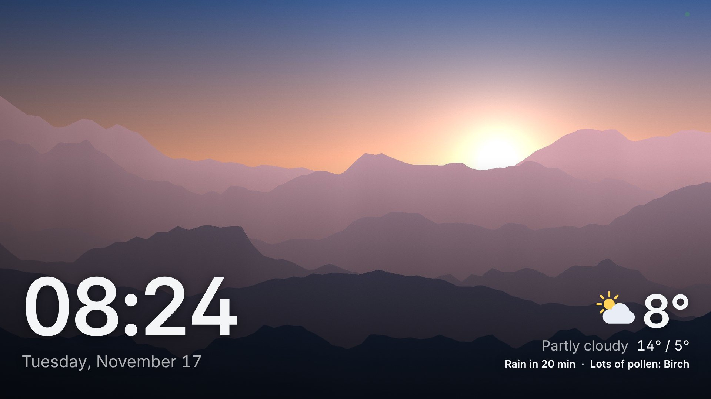
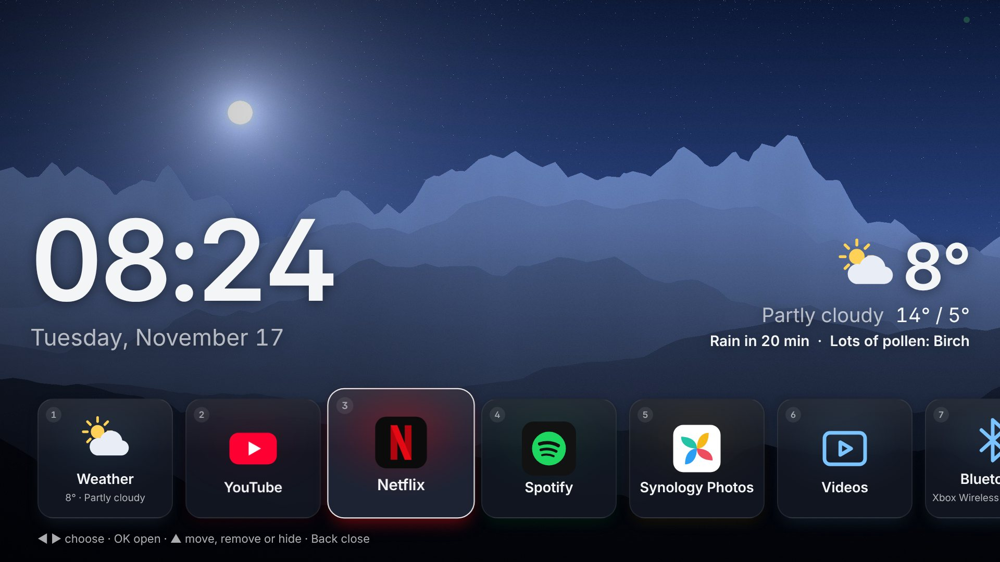
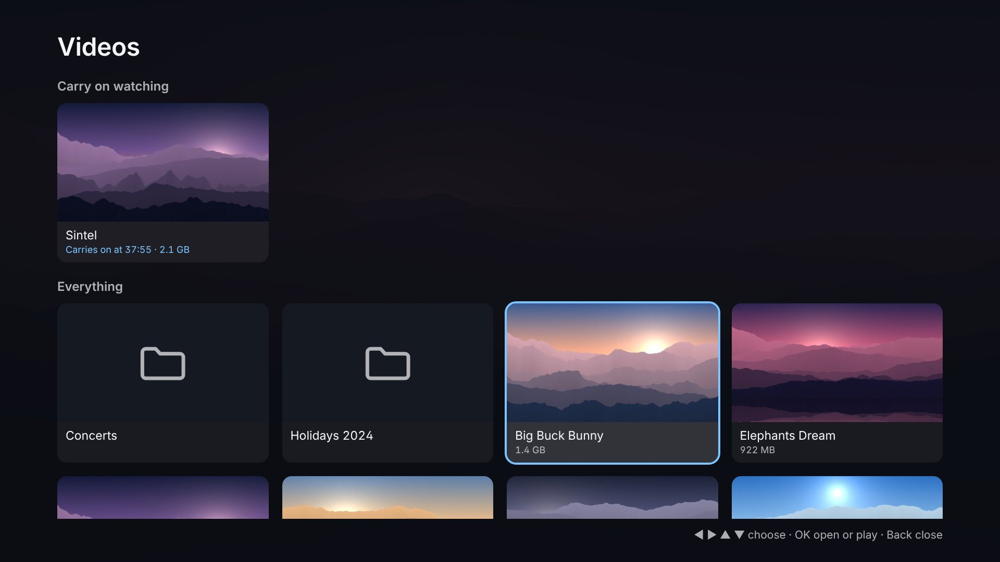
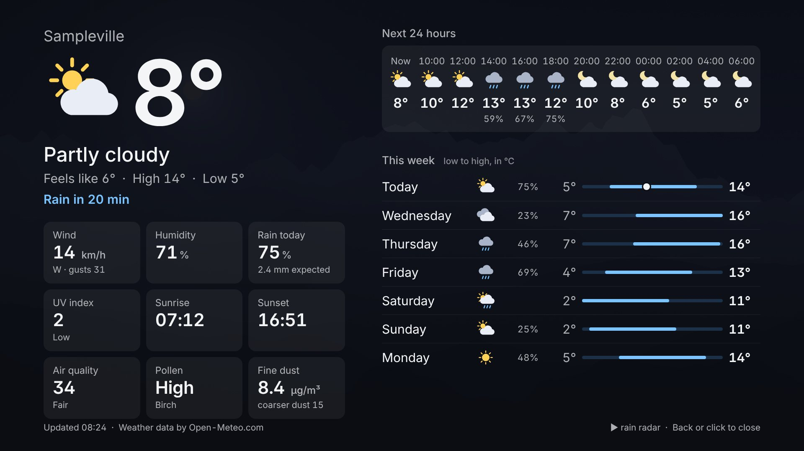
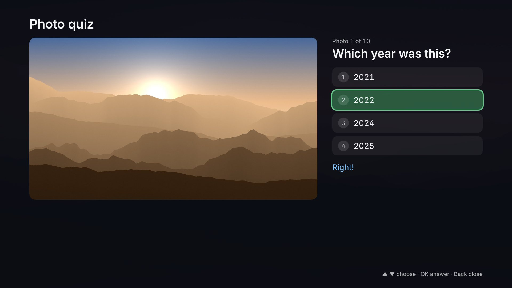
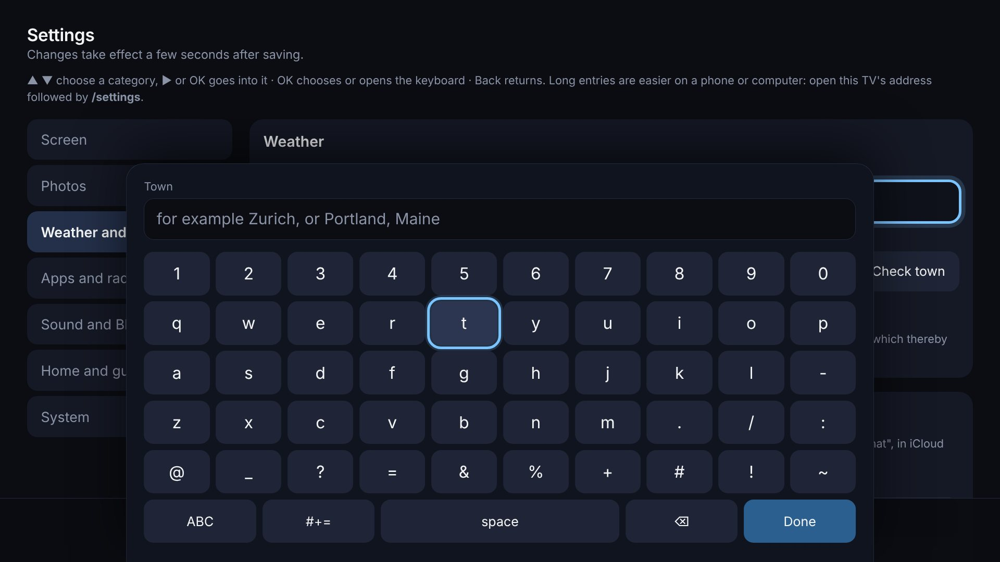

# PiDash

A calm screen for the TV when nothing is on: your photos, the time and the
weather, with YouTube, Netflix, your games and your films one press away.
It runs on a Raspberry Pi and is driven by the TV's own remote.



## What it does

|  |  |
|---|---|
| **Apps one press away.** OK opens the row: YouTube, Netflix, Spotify and some thirty more, your own websites, and programs such as Moonlight and Kodi. | **Your films.** Folders on the Pi or the NAS, with covers, and what you began at the top to carry on with. |
|  |  |
| **Weather worth looking at.** The forecast, air and pollen, a rain radar that runs on into the next hour, and the next trams from your stop. | **More from your photos.** The places and trips they tell of on a map, a quiz ("which year was this?"), and paintings from a museum for a change. |

- **Photos** from Synology Photos, Immich, a shared folder on the network, or
  a folder on the Pi.
- **The TV's remote does everything**, over the HDMI cable (HDMI-CEC). Game
  controllers work too, and a phone can stand in as remote, mouse and keyboard.
- **Music**: radio stations, and the TV as a speaker for phones (Spotify
  Connect, AirPlay), with what is playing on screen.
- **Settings on the TV itself**, with an on-screen keyboard, or from a phone
  or computer. English, German, French and Italian.
- **It looks after itself**: updates at night if you like, switches the TV
  off when nobody is there, dims in the evening, and shows only a clock at
  night.

It sits on top of the Pi's normal desktop. Nothing is flashed, the way the Pi
starts is not changed, and it can be removed again.

## What you need

A **Raspberry Pi 5 or 4** with Raspberry Pi OS and its desktop (Bookworm or
newer), connected to the TV by HDMI and to the internet. It also runs on
other ARM boards and ordinary PCs, and as a
[container](https://github.com/DarioRomano/PiDash/wiki/Container) that serves
the dashboard to any browser:
[what to expect on each](https://github.com/DarioRomano/PiDash/wiki/Other-computers).

## Install

In a terminal on the Pi, as your normal user:

```sh
curl -fsSL https://raw.githubusercontent.com/DarioRomano/PiDash/main/install.sh | bash
```

This downloads the latest release, checks it against its checksums and
installs it into your home directory. Then open **PiDash** from the desktop
menu. The first time, it asks three things with the remote: the language,
your town for the weather, and where your photos are.

- **To have it start with the desktop**, add `--autostart` to the line
  above: `… | bash -s -- --autostart`.
- **To update**: on the settings page, or `bash ~/.local/share/pidash/update.sh`.
- **To remove it**: `bash ~/.local/share/pidash/uninstall.sh`; with `--purge`
  your settings go too.
- **If something does not work**: `bash ~/.local/share/pidash/doctor.sh`
  says what it finds, and there is
  [Troubleshooting](https://github.com/DarioRomano/PiDash/wiki/Troubleshooting).

## Using it

| Button on the TV's remote | Does |
|---|---|
| **OK** | Opens the app row; chooses |
| **◀ ▶** | The previous and the next photo; move along the row |
| **▲** | What can be done with the photo on screen: hide it, its place, art instead of photos |
| **▼** | More, or less, beside the photo: the forecast, the calendar, only the picture |
| **Back** | Back. Inside an app: hold it, or press it three times quickly, to return to the dashboard |



## Documentation

The [wiki](https://github.com/DarioRomano/PiDash/wiki) has the guide:

- **Getting it running**:
  [Installation](https://github.com/DarioRomano/PiDash/wiki/Installation) ·
  [Other computers](https://github.com/DarioRomano/PiDash/wiki/Other-computers) ·
  [Container](https://github.com/DarioRomano/PiDash/wiki/Container) ·
  [Troubleshooting](https://github.com/DarioRomano/PiDash/wiki/Troubleshooting)
- **Using it**:
  [The dashboard](https://github.com/DarioRomano/PiDash/wiki/Using-the-dashboard) ·
  [Settings](https://github.com/DarioRomano/PiDash/wiki/Settings) ·
  [Photos](https://github.com/DarioRomano/PiDash/wiki/Photos) ·
  [Weather, calendar and departures](https://github.com/DarioRomano/PiDash/wiki/Weather-calendar-and-departures) ·
  [Apps](https://github.com/DarioRomano/PiDash/wiki/Apps) ·
  [Games and videos](https://github.com/DarioRomano/PiDash/wiki/Games-and-videos) ·
  [Music and sound](https://github.com/DarioRomano/PiDash/wiki/Music-and-sound) ·
  [TV and remote](https://github.com/DarioRomano/PiDash/wiki/TV-and-remote) ·
  [Performance and status](https://github.com/DarioRomano/PiDash/wiki/Performance-and-status)
- **About the project**:
  [Security](https://github.com/DarioRomano/PiDash/wiki/Security) ·
  [Development](https://github.com/DarioRomano/PiDash/wiki/Development)

Every setting is also described where it is set: in
[config.example.toml](config.example.toml).

## State of the project

PiDash is developed for the Raspberry Pi 5. Much of it is tried
automatically on every change, down to installing a release and updating
it; what needs a TV, a remote or a sound card is tried on fewer machines
than there are. If something does not work on yours,
[an issue](https://github.com/DarioRomano/PiDash/issues) with the output of
`doctor.sh` is welcome.

## License

MIT, see [LICENSE](LICENSE). The pictures of services on the app tiles are
simple drawings in their colours, not the services' own artwork.
