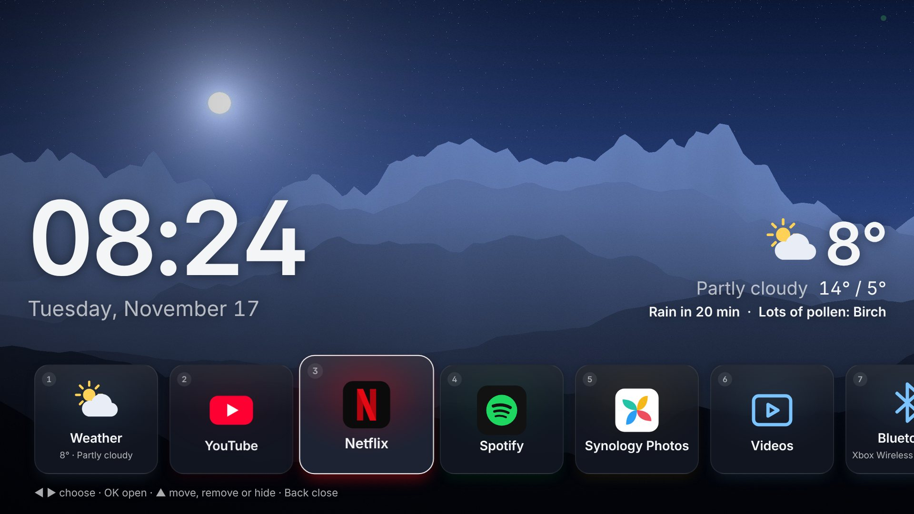

## Apps

Press **OK** on the dashboard to open the app row. Left alone for 30 seconds,
the row closes again and the TV returns to the clock; `app_row_timeout` under
`[display]` changes that, and `0` keeps it open.

To change the order, select an app in the row and press ▲: the tile lifts.
◀ ▶ carry it, **OK** puts it down and saves the order, **Back** returns it to
where it was. With a [lock](Settings#lock) set, apps are moved on the settings page
instead.

The easiest way to add apps is the [settings page](Settings#settings): under **Apps
and radio**, the apps PiDash knows are laid out as cards with their pictures.
Pressing a card adds it; one that needs something first (the address of your
own server, say) asks for it. What is in the list already is marked.

| | Ready-made |
|---|---|
| Films, series and TV | YouTube, Netflix, Disney+, Prime Video, Apple TV+, HBO Max, Paramount+, DAZN, Crunchyroll, Twitch, Zattoo, ARTE, ARD Mediathek, ZDF, Play SRF, Play Suisse, BBC iPlayer |
| Music | Spotify, YouTube Music, Apple Music, TIDAL, Deezer, SoundCloud |
| Games | Moonlight, Steam Link, GeForce NOW, Xbox Cloud Gaming, and the [emulators](#emulators) |
| From your own server | Plex, Jellyfin, Kodi, Synology Photos, Immich |
| Something else | any other website, or any program installed on the Pi |

Apart from YouTube, whose TV pages are made for a remote, these are the
services' ordinary websites, opened fullscreen in Chromium with
[the remote's arrows moving around the page](#websites-made-for-a-mouse).
How well each of them takes to that differs, and a service may change its
pages at any time; the phone's touchpad is there for what the arrows do not
reach. The paid ones need the copy protection module that Raspberry Pi OS
and Google Chrome bring, and some of them send a Linux browser less than
their best picture. The pictures on the cards are simple drawings in each
service's colours, not the services' own artwork.

Apps can also be defined in `~/.config/pidash/config.toml`, one `[[apps]]`
block each. After editing, run `systemctl --user restart pidash`. An app is
either a website or a program.

### Spotify

**Spotify** in the list of ready-made apps opens the Spotify web player in
Chromium, and keeps playing when you return to the dashboard (see
[Now playing](Music-and-sound#now-playing)). The player is made for a mouse, so PiDash has
the browser [move with the arrows](#websites-made-for-a-mouse): the remote's
arrows go from one cover, button or list entry to the nearest in their
direction, OK presses it, and the remote's play button starts and pauses.
Typing into the search field needs the phone's keyboard. Setting its size to
150% or more helps on a 4K screen.

### YouTube, Netflix and other websites

A website app opens fullscreen in its own browser profile, so its login is
remembered and kept apart from your normal browser. The default config ships
with these two:

```toml
[[apps]]
id = "youtube"
name = "YouTube"
url = "https://www.youtube.com/tv"
browser = "chromium"
user_agent = "Mozilla/5.0 (PS4; Leanback Shell) Gecko/20100101 Firefox/65.0 LeanbackShell/01.00.01.75 Sony PS4/ (PS4, , no, CH)"

[[apps]]
id = "netflix"
name = "Netflix"
url = "https://www.netflix.com/browse"
```

- **YouTube** opens YouTube's TV interface, which is built for remote
  controls: the arrow keys and OK on your TV remote work. The `user_agent`
  line is what makes YouTube serve that interface.
- **A website in Firefox with an ad blocker.** With `browser = "firefox"` and
  `adblock = true` the browser add-on **uBlock Origin** is put into the
  app's profile: it is downloaded from Mozilla's add-on site the first time
  the app starts, and Firefox keeps it updated. It is made for ordinary
  websites, which expect a mouse.
- **Netflix** runs in Chromium, because Raspberry Pi OS provides the DRM module
  Netflix requires (`libwidevinecdm0`) for Chromium. The installer adds it if
  it is missing.

### Synology Photos

Add a block with the address you normally open Synology Photos with in a
browser:

```toml
[[apps]]
id = "synology-photos"
name = "Photos"
url = "http://192.168.1.20:5000/?launchApp=SYNO.Foto.AppInstance"
```

If your NAS uses HTTPS with a self-signed certificate, the browser will show a
warning page first. Use the plain `http://` address on your home network, or a
real certificate.

### Websites made for a mouse

YouTube's and Netflix's TV pages are made for a remote. Most other websites
are made for a mouse, and the arrows of a remote only scroll them. For such
a site, tick **Made for a mouse: let the remote's arrows move around the
page** when adding it under **Apps** (in `config.toml`: `arrows = true`).
Chromium then moves a highlight from one link or button to the nearest one
in the direction of the arrow, scrolling as needed, and **OK** presses it.
Spotify's tile has this by itself.

It suits pages of links, covers and buttons. Sliders, maps and things that
are dragged still need a pointer: the phone's touchpad
([Phone as mouse and keyboard](TV-and-remote#phone-as-mouse-and-keyboard)) or a mouse. A
page that uses the arrows itself keeps them. It is not available for a site
opened in Firefox.

### Things to know about website apps

- **Signing in needs typing once.** Use the phone as keyboard (see
  [Phone as mouse and keyboard](TV-and-remote#phone-as-mouse-and-keyboard)) or plug in a
  keyboard for the first login to Netflix or your NAS. The login is remembered.
- **Netflix and Synology Photos expect a mouse.** Their websites are not built
  for arrow-key navigation. The phone's touchpad covers this. YouTube's TV
  interface works with the TV remote alone.
- **Getting back.** Hold Back on the TV remote for two seconds, tap **Back to
  dashboard** on the phone remote, or press Alt+F4 on a keyboard.
- **If uBlock Origin is not active** in an app that uses Firefox, Firefox on your system
  did not accept the automatic install. The reliable alternative applies to
  every Firefox profile on the Pi. Create `/etc/firefox/policies/policies.json`:

  ```json
  {"policies": {"ExtensionSettings": {"uBlock0@raymondhill.net": {
    "installation_mode": "force_installed",
    "install_url": "https://addons.mozilla.org/firefox/downloads/latest/ublock-origin/latest.xpi"}}}}
  ```

### Browser extensions for a website app

A website app can load browser extensions of your choosing. Put each one,
unpacked (a folder with a `manifest.json` in it, as Chromium's "Load
unpacked" takes them), into a folder named after the app's id:

```
~/.local/share/pidash/extensions/<app id>/<any name>/manifest.json
```

They are loaded the next time the app starts, and only into that app, which
has a browser profile of its own. Extensions are Chromium's kind, so an app
with a folder there runs in Chromium, whatever browser its settings name.
The app's id is the `id` in `config.toml`; for the apps offered on the
settings page it is their name in lower case (`youtube`, `netflix`).

PiDash brings no extensions itself and does not look at what yours do. An
extension can read and change everything on the pages it is made for, with
the account signed in there: load only what you trust.

### Programs: Moonlight, Kodi, Steam Link and others

```toml
[[apps]]
id = "moonlight"
name = "Moonlight"
command = "moonlight-qt"
mode = "console"

[[apps]]
id = "steamlink"
name = "Steam Link"
command = "steamlink"
```

Each program has a `mode`:

- **`desktop`** (the default) runs the program on the desktop, as if you had
  started it from the menu. No extra setup.
- **`console`** runs it on its own screen outside the desktop, the one you would
  reach with Ctrl+Alt+F8. The app then drives the display directly, which is
  what Moonlight and Kodi want: lower latency, HDR, and switching the refresh
  rate to match the content. When the app ends you are returned to where you
  were, and the desktop is untouched underneath.

Console mode needs a one-time setup, because starting something on another
screen requires system permissions:

```sh
make install PI_HOST=pi@raspberrypi.local INSTALL_FLAGS=--console-apps
# or, on the Pi:  bash deploy/install.sh --console-apps
```

This is the only system-wide part of PiDash. It adds three files: a systemd
unit, a small script that switches screens, and a rule that lets your user start
and stop that unit without a password. Apps still run as you, not as root. The
uninstaller removes all three.

To leave a console app, hold Back on the TV remote for two seconds, use the
app's own quit shortcut, or tap **Back to dashboard** on the phone remote.

### Emulators

The settings page offers these emulators by name under **Add an app**. All of
them run well on a Pi 5, except that Dolphin only manages the lighter games
at full speed:

| Emulator | Plays | Install on the Pi |
|----------|-------|-------------------|
| RetroArch | Many classic consoles, from the NES and Mega Drive to the first PlayStation | `sudo apt install retroarch` |
| PPSSPP | PlayStation Portable | `flatpak install flathub org.ppsspp.PPSSPP` |
| Mupen64Plus | Nintendo 64 | `sudo apt install mupen64plus-qt` |
| Dolphin | GameCube and Wii | `flatpak install flathub org.DolphinEmu.dolphin-emu` |
| ScummVM | Point-and-click adventures | `sudo apt install scummvm` |
| DOSBox | DOS games | `sudo apt install dosbox` |
| MAME | Arcade machines | `sudo apt install mame` |

One that is not installed yet is listed with its install command; after
installing it, open the settings page again and add it. PiDash finds an
emulator through its entry in the Pi's application menu, whether it came from
`apt` or from Flatpak, and starts RetroArch, PPSSPP, ScummVM and DOSBox
filling the screen. Any other emulator in the menu can be added with **A
program installed on the Pi…**.

PiDash starts the emulator; the games are yours to supply, and each emulator
has its own way of being told where they are. RetroArch also needs a "core"
per console: `apt search libretro` lists the ones Raspberry Pi OS has.

Inside an emulator the [game controller](TV-and-remote#game-controller) belongs to the
game. **Holding its logo button for two seconds** returns to PiDash, as does
holding Back on the TV remote.

### Icons

You do not need to configure icons. PiDash picks one for each app in this order:

1. `icon` in the app's block, if you set one: a path to an SVG or PNG.
2. A built-in icon for YouTube, Netflix and Synology Photos. These are simple
   drawings in each service's colours, not the official artwork.
3. For programs, the icon the installed program ships with, found through its
   desktop menu entry. This covers Moonlight, Kodi, Steam Link and anything
   else that appears in the desktop menu, including Flatpak apps.
4. A globe for other websites, or the first letter of the name.

## The TV remote inside apps

A TV remote's **OK** and **Back** buttons are not keyboard keys, so apps such
as YouTube and Netflix would ignore them. PiDash reads the remote itself and
fills the gap:

- **OK** is passed on to the app as Enter, and **Back** as Escape. The number
  buttons are passed on as numbers. Arrows already work by themselves.
- **Holding Back for two seconds** closes the app and returns to the dashboard.
  Holding **Esc** on a keyboard does the same.
- **Pressing Back three times quickly** does so too. Some TVs, Samsung's among
  them, never tell the Pi that a button is being held: however long the
  finger stays, one press arrives. The first two presses still go to the app
  as Back.

Buttons go to whichever window has the keyboard. An app's window gets it when
it opens, but can lose it, for example when the TV is switched off and on
again; the app then looks as if the remote had stopped working. PiDash checks
on every button press that the open app's window has the keyboard and gives
it back if not. PiDash asks the desktop for this itself; nothing extra needs
installing on Raspberry Pi OS (on a desktop with X11 it uses `xdotool`). It
works for websites and for programs added from the list of installed
programs. The [status page](Performance-and-status#status-page) says whether it is available.

This works in every app, including ones that run outside the desktop. It needs
your user to be in the `input` group, which is the case for the first user on
Raspberry Pi OS, and the one system rule the installer adds. The installer and
`doctor.sh` tell you if either is missing.

Some TVs report a held button as a quick series of presses, which PiDash
takes for holding. For those that report nothing, the three presses are
there; how many it takes is `app_exit_presses` under `[input]` (0 switches it
off). A button you do not otherwise need, such as a colour key, can also be
made to leave an app at once:

```toml
[input]
app_exit_keys = ["KEY_RED"]
app_exit_hold = "0s"
```

`sudo apt install evtest && sudo evtest` shows the name of any button you press.
