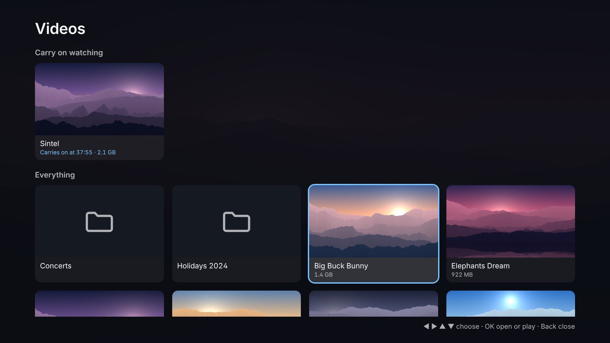

## Games

Your games are behind one **Games** tile, after the apps. **OK** on it opens
a page with their covers, six to a row; the arrows move, **OK** plays,
**Back** closes. The one played last comes first, so the game of the moment
is where the page begins. The tile says how many games there are, and the
app row opens on it after a game.

Under Settings, Apps, *Show the games themselves* turns the games on or off
(`moonlight` and `retroarch` under `[games]`), and *On a page of their own*
chooses between this page and a tile for every game in the app row (`page`
under `[games]`).

**From RetroArch.** With **RetroArch** in the app row, the games you marked as
favourites in RetroArch get a tile each, followed by the ones played last, up
to 24. **OK** starts the game directly, with the core it was last played
with, and shows RetroArch's own cover where it has downloaded one. To give a
game a tile, play it once in RetroArch, or add it to RetroArch's favourites
(in RetroArch's quick menu, *Add to Favorites*). A game whose file or core
has gone gets no tile.

**From your PC.** With **Moonlight** in the app row and paired with your PC, the games the PC
offers get tiles of their own, after the apps. **OK** on one wakes the PC if
it is asleep, waits for it, and starts that game; the TV says "Waking …"
meanwhile. A PC that does not come up within a minute and a half is reported
as such.

The list is Moonlight's own: PiDash reads it from Moonlight's settings, with
the covers Moonlight has fetched. Open the PC once in Moonlight to fill it,
and again after adding a game on the PC. Games you hid in Moonlight stay
hidden. Games cannot be moved by hand.

Waking needs the PC to be set up for it (Wake-on-LAN, a network cable), and
Moonlight to have seen the PC at least once, which is how its network card
becomes known.

## Videos

**Videos** in the app row walks through folders of films and home videos and
plays one full screen. Set it up under Settings, Apps and radio, *Videos*,
or in `config.toml`:

```toml
[videos]
source = "folder"                  # or "synology"
folders = ["/home/pi/Videos"]
```

- **In a folder on this Pi** (`source = "folder"`): one or more full paths.
  A USB drive, or a share of the NAS that is mounted on the Pi, counts.
- **On the Synology NAS the photos come from** (`source = "synology"`): the
  shared folders of the NAS, read through File Station with the NAS account
  already entered for the photos. `folders = ["/video"]` offers that shared
  folder; left empty, every shared folder the account may read is offered.
  The account needs permission for File Station and read access to the
  folder. Nothing is copied to the Pi: the player asks PiDash for the part
  of the file it needs, and PiDash fetches that part from the NAS.

On the page, folders come first and names are in the order people count
(Episode 2 before Episode 10). **OK** opens a folder or plays a video,
**Back** goes to the folder above and closes the page at the top. The page
opens in the folder that was open last. Files a NAS keeps for itself
(`@eaDir`, `#recycle`) are left out.

**Covers.** Every video has a picture on its card. It is the picture that
lies beside the video under its name, as media libraries keep them
(`Alien.jpg` or `Alien-poster.jpg` for `Alien.mkv`), or else a frame from a
little way into the video, which the player takes out of it the first time
the folder is looked at. That takes a second or two a video on a Pi, one
after the other, so a folder fills in as you watch; afterwards the pictures
are kept (`~/.cache/pidash/video-covers`), and none are made while a video
plays. A file that is replaced gets a new one.

**Carry on watching.** At the top of the first page are the videos that
were begun and not finished, the one watched last first, each with the
place it carries on at. A video that is watched to its end leaves that row
by itself.

Videos are played by **mpv**, which a Pi may need first:

```bash
sudo apt install mpv
```

Where mpv is missing VLC is used, with fewer of the remote's buttons. With
mpv:

| Button | Does |
|--------|------|
| **OK**, play/pause | Pause and carry on |
| ◀ ▶ | Back 10 seconds, forward 30 |
| ▲ ▼ | Forward and back five minutes |
| **1** | Next subtitles, or none |
| **2** | Next language |
| **3** | Where in the video it is |
| **0** | From the beginning |
| **Back** | Stop, and remember where |

A video that was stopped carries on where it stopped; its card says at
what time, and it is under **Carry on watching** on the first page.
Subtitles in a file of the same name beside the video (`Film.srt`,
`Film.en.srt`) are loaded with it. While a video plays the dashboard is
out of the way, as with an app; when it ends, the page is where it was.

PiDash writes its settings for mpv to `~/.local/share/pidash/videos/mpv/`
(`mpv.conf` and `input.conf`). To change them, edit the file and remove its
first line; PiDash then leaves it alone. Another player can be named with
`player = "…"` under `[videos]`: the video is given to it as its last
argument.

What plays smoothly depends on the Pi: a Pi 5 decodes H.265 (HEVC) in
hardware up to 4K and H.264 in software, which is fine up to 1080p.
