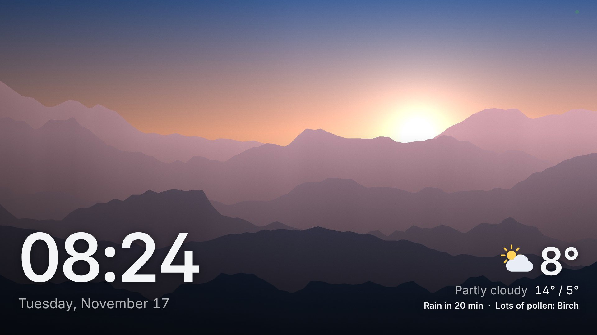

PiDash turns a Raspberry Pi into a calm screen for the TV: your photos, the
time and the weather, with apps, games and films one press away, all driven
by the TV's own remote.

New here? [Installation](Installation) takes one line, and the dashboard asks
its three questions on the first start. The short version of everything is
in the [README](https://github.com/DarioRomano/PiDash#readme).

## Getting it running

| Page | What is in it |
|---|---|
| [Installation](Installation) | Installing on a Raspberry Pi, updating, uninstalling, the first start |
| [Other computers](Other-computers) | A Pi 4, other ARM boards, ordinary PCs: what to expect on each |
| [Container](Container) | The dashboard alone for any browser, with Docker; on a Synology NAS |
| [Troubleshooting](Troubleshooting) | When something does not work |

## Using it

| Page | What is in it |
|---|---|
| [Using the dashboard](Using-the-dashboard) | The remote's buttons, keyboard and mouse, language and layout, night mode |
| [Settings](Settings) | The settings page, the lock, backups, Wi-Fi for visitors |
| [Photos](Photos) | Synology Photos, Immich, a shared folder; places, trips, the quiz, art mode |
| [Weather, calendar and departures](Weather-calendar-and-departures) | The forecast and rain radar, the calendar, the next trams and trains |
| [Apps](Apps) | YouTube, Netflix, Spotify and the others; your own websites and programs |
| [Games and videos](Games-and-videos) | Games from your PC and emulators; films from the Pi or the NAS |
| [Music and sound](Music-and-sound) | Radio, what is playing, the Pi as a speaker for phones, Bluetooth |
| [TV and remote](TV-and-remote) | Switching the TV on and off, other devices on the TV, game controllers |
| [Performance and status](Performance-and-status) | What a Pi can do at 4K, keeping it cool, the status page |

## About the project

| Page | What is in it |
|---|---|
| [Security](Security) | What PiDash guards against, and what it fetches from outside |
| [Development](Development) | Building, the tests, releasing, where things are in the code |
