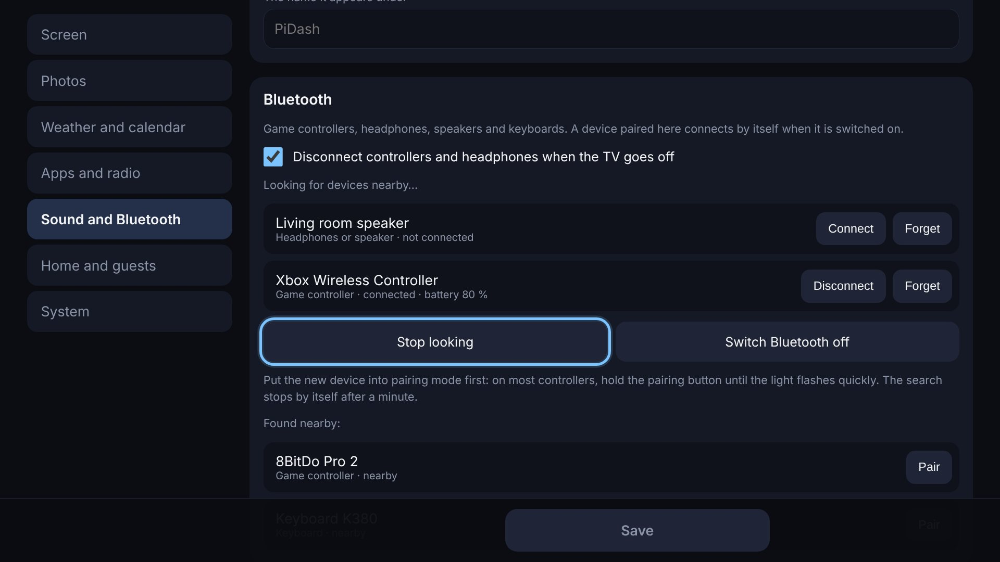

## Radio

Internet radio stations sit in the app row as tiles. **OK** on a station
plays it while the photos carry on; **OK** again stops it. The remote's play
button pauses and resumes. Opening an app, or the TV being switched off, stops
the radio.

Add stations on the settings page under **Radio**: type part of the name,
press **Search**, pick the station from the results and add it. The search
uses the community directory radio-browser.info. Stations can also be written
into `config.toml` with the address of their stream:

```toml
[[radio]]
name = "Radio Swiss Jazz"
url = "https://stream.srg-ssr.ch/m/rsj/mp3_128"
```

## Now playing

When music plays somewhere on the Pi, the dashboard shows a small card with
its cover, title and artist. The remote's **play/pause** button then pauses
the music instead of the slideshow, and its **skip** buttons go to the next
and previous piece instead of the next photo.

PiDash learns this from the players themselves, which announce on the Pi's
desktop what they are playing: browsers (Spotify, YouTube), Spotify Connect
and AirPlay receivers, media players. Nothing has to be set up, and nothing is
asked again and again; a player says when something changes.

**Music behind the dashboard.** Leaving Spotify (holding Back) does not close
it: it is put behind the dashboard and plays on, with the photos and the
"now playing" card in front. Its tile says **Playing · OK to open**, and OK
brings it back as it was. **Stop Spotify** in the app row ends it; so does
opening another app. Any website app can do this with `background = true` in
its `[[apps]]` block. It needs a desktop that lets PiDash choose which window
is in front, as Raspberry Pi OS's does; elsewhere the app is closed as before.

## Sound

**Settings → Sound** chooses where the Pi's sound comes out, and how loud:

- **Sound comes out of** lists the outputs: the TV over HDMI (a Pi 5 lists
  both of its HDMI sockets), and Bluetooth headphones or speakers once they
  are connected under [Bluetooth](#bluetooth). Choosing one takes effect at
  once, and what is playing moves over.
- **−** and **+** change the volume of that output in steps of five percent;
  **Mute** silences it. For the TV, leave this at 100 % and use the TV's own
  volume buttons.
- **Play a test sound** plays two notes on the chosen output, on the Pi, so it
  also tells which output is which when the page is open on a phone.

**Headphones.** When Bluetooth headphones or a speaker connect, the sound
moves to them, and when they disconnect it returns to where it was before:
putting headphones on and taking them off is all there is to it. Devices that
are already connected when PiDash starts are left as they are, and an output
chosen by hand stays chosen. The switch for this is at the bottom of the
Sound section (`follow_bluetooth` under `[sound]` in `config.toml`).

While there is more than one output to choose from, the app row has a
**Sound** tile that says where the sound is. **OK** on it moves the sound to
the next output, and a short sound confirms it from there. An HDMI socket
with nothing plugged in is left out, and marked as such in the settings.

This uses `pactl`, the command-line tool of the Pi's sound service, which the
installer adds if it is missing.

**Volume from the remote.** A TV's volume buttons change the TV's own volume
and never reach the Pi, so with headphones or a Bluetooth speaker they do
nothing. While the sound goes to anything but the TV, the remote's **channel
up** and **channel down** buttons are the volume instead, in steps of 5 %,
on the dashboard and inside apps; the dashboard shows the new level for a
moment. With the sound on the TV they are the next and the previous photo, as
before. `remote_volume = false` under `[sound]` switches this off.

## Speaker for phones

The Pi can be a speaker that phones play to: you choose the music in the
Spotify app, or on an iPhone, iPad or Mac, pick the TV as where it should
play, and it plays here, with the title and cover on the dashboard like any
other music ([Now playing](#now-playing)). The TV is not switched off for
want of a button while it plays.

PiDash does not speak Spotify's or Apple's language itself. Two well-known
programs do, and PiDash runs them when they are installed and switched on
under **Settings, Sound and Bluetooth, Speaker for phones**:

| | Program | Getting it |
|---|---|---|
| Spotify (Spotify Connect; needs Spotify Premium) | `librespot` | Not among Raspberry Pi OS's packages. The [raspotify](https://github.com/dtcooper/raspotify) project offers it as a package for the Pi; on Arch it is `librespot` |
| AirPlay (sound from Apple devices) | `shairport-sync` | `sudo apt install shairport-sync` |

Installed as packages, both start a copy of their own for the whole system,
which would be in the way of PiDash's. Running the installer with
`--speakers` installs what the system offers and switches those copies off;
by hand it is `sudo systemctl disable --now shairport-sync raspotify`.

PiDash starts them under the name set on the settings page ("PiDash" unless
you choose another), and has their sound go through the desktop's sound, so
that it comes out where **Sound** sends it: the TV, or headphones. The card
on the settings page says for each whether it runs, and if not, what the
program said. In `config.toml` this is `spotify_connect`, `airplay` and
`speaker_name` under `[sound]`.

Things to know:

- Play, pause and skip are on the phone. The remote's buttons do nothing
  for music that a phone plays.
- The title and cover need a recent librespot (0.5 or newer); an older one
  plays without saying what. The cover is fetched from Spotify by the Pi.
- Debian's shairport-sync is the classic AirPlay: one speaker, sound only.
  Playing to several rooms at once (AirPlay 2) needs a copy built for it.
- With two phones playing at once, the dashboard shows the one that began
  last. A phone's music comes before music an app on the Pi plays.

## Bluetooth

**Quickly, from the dashboard.** ▲ and the last button of
[the photo's bar](Photos#the-photos-bar), or the **Bluetooth** tile in the app row, lists
the devices the Pi knows, with whether each is connected and its battery.
**OK** on one connects or disconnects it; the list stays open, so headphones
can be swapped for a speaker in two presses. The tile itself names what is
connected. **Pair a new device…** at the end opens the settings at the right
place.

**Settings → Sound and Bluetooth** manages the devices with the TV remote, so
pairing a controller does not need a mouse and the desktop:

- The devices the Pi knows are listed with **Connect** / **Disconnect** and
  **Forget**.
- **Look for new devices** searches for a minute. Put the new device into
  pairing mode first (on most controllers: hold the pairing button until the
  light flashes quickly), then press **Pair** on its row.
- A paired device is trusted, so from then on it connects by itself when it is
  switched on. For a controller that also [switches the TV on](TV-and-remote#game-controller).
- **Switch Bluetooth off** switches the Pi's Bluetooth off entirely.

Controllers, headphones, speakers, mice and most keyboards pair this way. A
device that insists on a code being typed is paired from the desktop's
Bluetooth menu instead. Headphones and speakers are connected here; that the
sound then comes out of them is chosen under [Sound](#sound).

A connected device that reports its **battery** has it shown in its row and
on the [status page](Performance-and-status#status-page), and the TV says so once when it falls to
15 %. Many controllers report it; some, and most speakers, do not.

Things nearby that have no name (other people's phones, beacons) are left out
of the list. With a [lock](Settings#lock) set, changes ask for the PIN.
