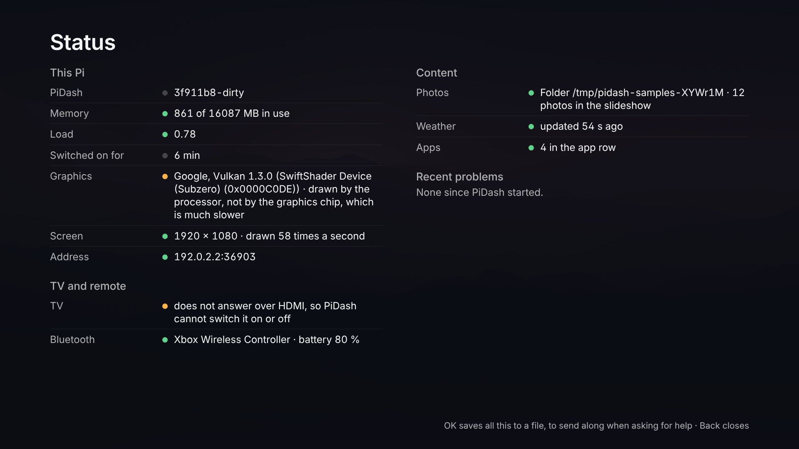

## Performance

**Settings → Screen → Performance** chooses how much work the Pi does for the
picture, which is what decides how much power it draws and how warm it gets:

| Preset | Moving background | Photos | Fade to the next photo | Video clips |
|--------|-------------------|--------|------------------------|-------------|
| **Smooth** | 30 pictures a second | move as set, redrawn 30 times a second | every refresh of the TV | shown |
| **Balanced** (default) | 12 a second | move as set, redrawn 15 times a second | 15 steps a second | shown |
| **Power saver** | 5 a second, drawn less finely | stand still | 7 steps a second | left out |

**Menus are not slowed down by any of this.** The app row, the settings and
every other menu are drawn as often as the TV shows a picture, and so is what
a button sets in motion in the background (it lifts as the app row opens and
sways as the highlight moves). That lasts a second and costs next to nothing
over a day; what the presets slow down is the picture behind the clock, which
is drawn all day long.

**Nothing moves, nothing is drawn.** A photo that stands still, with the
clock beside it, costs the Pi nothing: the browser draws a picture only when
something on it changes, and then only that. Measured over ten seconds, a
still photo was drawn 0 times, a moving one 150 times (15 a second), and the
moving background 12 times a second. The clock changes once a minute, and one
photo gives way to the next every half minute or so. So the work is all in
what moves: photos that drift, the moving background, and the second or two
in which a menu opens or a photo fades in.

Measured in a browser without a graphics chip, where every picture is drawn
the slow way, the browser's share of the processor was:

| What is on screen | Before v0.15 | Since |
|-------------------|--------------|-------|
| A photo, a new one every 30 s | 13 % | 5 % |
| A photo, a new one every 10 s | 38 % | 14 % |
| Photos that move | 65 % | 65 % |
| The TV shows another input, with photos or the moving background | 13 to 65 % | under 1 % |

The fade to the next photo was drawn on every refresh of the TV, and then
the photo underneath was faded out once more where nobody could see it. It
is now drawn in 15 steps a second and the photo underneath goes at once.
Photos that move are what costs most by far, because what is on screen
really changes 15 times a second.

**Is the Pi's graphics chip doing the drawing?** It should be, and the
**Status** page says: **Graphics** names what the browser draws with. On a
Pi 5 that reads "V3D 7.1" or similar. If it names "SwiftShader" or
"llvmpipe", the processor is doing the graphics chip's work, everything is
many times slower, and that is the thing to fix first (usually by updating
Raspberry Pi OS).

**The largest saving at 4K: send the TV 1920 × 1080.** A 4K picture has four
times the pixels of a 1080p one, and filling pixels is what the Pi runs out
of. *Picture sent to the TV while PiDash runs: 1920 × 1080* (under
Performance) switches a TV that is set to more than that to 1920 × 1080 for
as long as the dashboard and its apps run, and back to what the desktop is
set to when you leave for the desktop. The TV enlarges the picture itself,
as it does for every broadcast and most films; photos look the same (they
are prepared at that size anyway), and small lettering is a little softer.
The TV goes dark for a moment at each change. This needs the tool
`wlr-randr`, which Raspberry Pi OS has and the installer adds if not.

```toml
[kiosk]
resolution = "1080p"    # or "desktop", the default
```

**What costs the most, especially at 4K.** The Pi puts the screen together
from layers, like sheets of glass laid over the photo, and at 3840 × 2160
every sheet as large as the screen is 8 million pixels to lay down, sixty
times a second. That, far more than anything that moves, is what a Pi 5 runs
out of. In order of cost:

1. **Sheets the size of the screen.** With a photo that stands still there is
   one: the photo, its darkening and the texts are painted together, and a
   menu that opens moves over that one sheet. A photo that drifts is a sheet
   of its own, with one for everything on top of it. Before v0.9.2 there
   were six, among them photos that were not showing.
2. **Painting something anew for every picture.** A tile whose colours change
   gradually has to be painted again and again while they change, with its
   soft shadows. The tiles are therefore finished pictures that are only
   moved, and their border and colour change at once.
3. **Soft shadows and glows**, which make each tile's picture larger than the
   tile. *Tiles of the app row: Plain* does without them
   (`tiles = "plain"`).
4. **How many pictures a second** the moving background and moving photos
   get: the presets above.

With these changes a run along the app row got three to five times as many
pictures through on the same graphics as before, and plain tiles about a
quarter more again. That was measured in a browser on slow test graphics, at
4K and at 1080p, not on a Pi; what your TV really gets is on the Status page:

If menus do not look fluid, open **Status** in the app row: **Screen** says
what size the picture is and how often it is really drawn. A TV shows 60
pictures a second. Clearly fewer at 3840 × 2160 means the Pi cannot keep up
at that size; set its screen to 1920 × 1080 (*Preferences → Screen
Configuration* on the Pi's desktop) and the TV does the enlarging, which it
is good at. Fewer at any size points to the TV or its cable (some run 4K at
30 pictures a second), or to a Pi that is busy with something else.

*Moving background: pictures a second* sets that one number by hand, whatever
the preset says: from 5 for a background that barely costs anything to 60 for
one as fluid as the TV can show. In `config.toml`:

```toml
[display]
performance = "saver"    # "smooth", "balanced" or "saver"
background_fps = 0       # 1 to 60, or 0 to leave it to the preset
```

Other things that save more than any preset: a background that does not move
at all (*Background without photos: Still picture*), photos that stand still
(Photos, *Movement: off*), and [night mode](Using-the-dashboard#night-mode), during which
nothing is drawn but a clock. While the TV is off nothing is drawn at all.

## Keeping the Pi cool

A picture that stands still costs the Pi nothing; anything that moves makes
it redraw the screen again and again, and at 4K that is what warms it. PiDash
therefore redraws what is on screen all day no more often than it needs:
moving photos 15 times a second and the drifting background 12 times, unless
[Performance](#performance) says otherwise. Menus, and what a button sets in
motion, are drawn on every picture the TV shows.

It also stops drawing when nobody can see it:

- **While the TV is off.** PiDash hears the TV announce that it is switching
  off, and asks it once a minute whether it is on, both over HDMI-CEC. While
  it is off, photos stop changing and moving, the background stands still and
  the radio stops. A button press, or the TV reporting that it is on again,
  brings everything back. This needs a TV that tells the truth about its
  power state; most do.
- **While the TV shows something else**: another of its inputs, or its own
  programme or apps. Photos stop changing and moving and the background
  stands still, as while it is off; the radio plays on, in case it goes to
  headphones. When the TV turns back to the Pi, or a button of its remote
  arrives, everything carries on. The TV says when it switches over
  HDMI-CEC; the **TV shows** line of the [status page](#status-page) tells
  whether yours does.
- **While an app is open**, and during [night mode](Using-the-dashboard#night-mode).

- **While the Pi is hot.** From 75 °C the background stands still and photos
  stop moving, though they keep changing; at 68 °C everything moves again.
  The seven degrees in between keep it from switching back and forth. The
  switch is under Settings, Screen; the temperature is `cool_above` under
  `[system]` in `config.toml`, and `0` switches it off. A Pi 5 slows itself
  down from 80 °C, so this steps in before that.

If the Pi still runs warm (check with `vcgencmd measure_temp`, or on the
[status page](#status-page)), these settings make the largest difference, most
effective first:

1. **Movement: None** for the photos (Settings, Background photos).
2. **Background without photos: Still picture** (Settings, Screen).
3. No video clips in the slideshow: decoding video is the heaviest work of all.
4. A longer time per photo: every new photo is prepared once on the Pi.

A case with a fan or a large heat sink is worth having for a Pi 5 that drives
a 4K screen all day.

## Status page

**Status** in the app row shows, on the TV, what would otherwise take a
keyboard and a terminal to find out:

- **This Pi**: the PiDash version and whether a newer one exists, temperature,
  memory, how busy the processor is, and the address to open on a phone.
- **TV and remote**: whether the TV answers over HDMI, its timetable, which
  remotes, keyboards and controllers PiDash is listening to, and the **last
  button** it heard, with the device it came from. Press any button while the
  page is open and it appears there within two seconds. A button that does
  not show up never reached the Pi: the TV is not passing it on.
- **Content**: where photos come from and how many there are, and when the
  weather and the calendar were last fetched, or why that failed.
- **Recent problems**: the latest warnings and errors since PiDash started,
  the same lines `journalctl --user -u pidash` would show.

**Processor** says how much of the time the processor was busy over the
last ten seconds, all its cores together: "12 % busy" while photos stand
still, more while something moves or an app runs. Lastingly above 85 % is
marked: the Pi has more to do than it can manage smoothly. Settings,
Screen, *How busy the processor is* can show the **load average** instead,
the number Linux and tools such as `top` give: roughly how many cores'
worth of work there was over the last minute, so on a Pi with 4 cores, 1 is
a quarter busy and above 4 is more than it can keep up with. *Both* shows
the two side by side.

```toml
[display]
processor = "percent"    # or "load", or "both"
```

Arrows do nothing on this page, so they can be tried out. **Back** closes it.
It shows no passwords and no calendar addresses.

**A file to send along.** **OK** on this page writes everything it shows,
the settings as the settings page has them (never a password), and the last
400 lines of PiDash's log to a file in your home folder on the Pi,
`pidash-diagnostics-<date>.txt`, and says where it is. That is what to send
when asking why something does not work. Only you can read the file, and
only the newest five are kept.

## Restart and shut down

The **Power** tile, last in the app row, offers three things: restart PiDash
(back in a few seconds), restart the Pi, and shut the Pi down. Whichever you
choose is asked about a second time, with **No** selected, so a press too many
does no harm. If a [PIN](Settings#lock) is set, these need it: unlock under
**Settings** first.

Restarting and shutting down the Pi need the Pi's permission. On Raspberry Pi
OS as it comes, the user who is logged in on the desktop has it. If the TV
says the Pi does not let PiDash do that, allow it once in a terminal:

```sh
echo "$USER ALL=(root) NOPASSWD: /usr/bin/systemctl reboot, /usr/bin/systemctl poweroff" | sudo tee /etc/sudoers.d/pidash-power
```

A Pi that was shut down starts again when its power is switched off and on.
