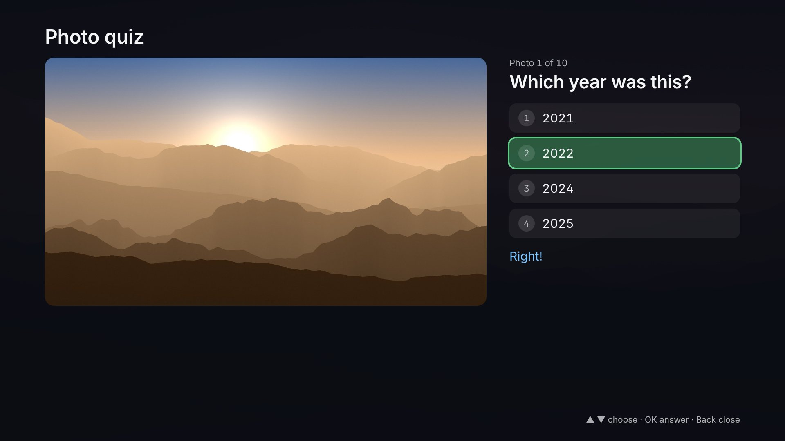

The photos behind the clock can come from four places. One is chosen under
**Settings, Photos**; which folders or albums of it are shown is chosen in
the folder picker, on a phone or on the TV.

| The photos are | See |
|---|---|
| in Synology Photos on a NAS | [Synology Photos](#background-photos-from-synology-photos) |
| in Immich on a server at home | [Immich](#photos-from-immich) |
| files in a folder that a NAS or a computer shares on the network | [A shared folder](#photos-from-a-shared-folder) |
| files in a folder on the Pi itself, or on a drive plugged into it | [A folder on the Pi](#photos-from-a-folder-on-the-pi) |

Further down: [how photos are shown](#how-photos-are-shown), [the photo's
bar](#the-photos-bar), [Places](#places), [Trips](#trips), the [photo
quiz](#photo-quiz), [art mode](#art-mode) and [what a photo's page
says](#about-this-photo).

## Background photos from Synology Photos

PiDash can show a slideshow behind the clock, taken from folders and albums you
choose in Synology Photos.

1. **On the NAS**, decide which account PiDash signs in with. A separate user
   that can only see the photos you want on the TV is the safest choice. The
   account must not use 2-step verification, because PiDash cannot answer the
   code prompt.
2. **On the Pi**, add this to `~/.config/pidash/config.toml`:

   ```toml
   [photos]
   source = "synology"

   [photos.synology]
   url = "http://192.168.1.20:5000"   # the address you open DSM with
   username = "pidash"
   password = "your-password"
   ```

   Then run `systemctl --user restart pidash`.
3. **On your phone**, open `http://<pi-ip>:8080/photos`. It is also linked from
   the phone remote as **Background photos**. Browse your Personal Space,
   Shared Space and Albums, tick what you want, and tap **Use these photos**.
   "Include the folders inside them" decides whether subfolders count. The TV
   switches to the new photos within a few seconds. Until you have chosen, the
   TV shows a message with this address.

You can change the choice at any time on the same page. New photos added to the
chosen folders and albums show up by themselves within six hours, or
immediately when you save the selection again.

**Albums** lists the account's own albums and the albums other people shared
with it. This makes a neat setup: collect the photos for the TV in one album in
your own account, share that album with the PiDash account, and tick it here.
The PiDash account then sees nothing else. If the share only allows viewing,
not downloading, PiDash uses the NAS's previews (1280 pixels on the long side)
instead of the full files.

- The NAS password is stored in the config file, which the installer makes
  readable by your user only.
- Like the phone remote, the folder picker is open to every device on your home
  network. Anyone on it can see the folder names and the chosen photos. Using a
  NAS account limited to the photos meant for the TV keeps that harmless.

## Photos from Immich

With [Immich](https://immich.app) on a server at home, choose **Immich on my
server** under **Background photos** on the settings page, and enter:

- the address Immich is opened with in a browser, like
  `http://192.168.1.20:2283`;
- an API key. Immich makes one under **Account Settings, API Keys**. PiDash
  only reads: a key that may read photos, albums and people is enough.

**Test connection** says whose key it is. After saving, all photos are shown
until you choose otherwise in the folder picker, which offers **All photos**,
**Favourites**, your **Albums**, and the **People** who were given a name.
Where the photos were taken comes from Immich, so [Places](#places) and
[Trips](#trips) work as with Synology Photos.

Photos in the bin, archived or hidden ones are left out, and so are videos.
With **Sharpest**, PiDash takes the full file where it is a JPEG, PNG or
WebP; for a phone's HEIC and for camera raw files it takes the copy Immich
keeps for viewing, which is what **Faster** uses for every photo.

In `config.toml`: `source = "immich"`, and `url` and `api_key` under
`[photos.immich]`.

## Photos from a shared folder

A folder that a NAS, a router with a disk, or a Windows or Mac computer
shares on the network can be used as it is: choose **A shared folder on the
network** and enter the computer's name or address, the share's name, and a
user and password that may read it (none for a share that guests may read).
A folder inside the share narrows it down. PiDash reads the share itself,
over SMB versions 2 and 3: nothing is mounted on the Pi and nothing needs
installing, and it never writes. **Test connection** says what went wrong in
words: nobody at that address, a name or password that is not accepted, no
such share or folder.

The pictures' dates and places are read from the files, as for a folder on
the Pi. Videos on a share are not shown.

In `config.toml`: `source = "share"`, and `host`, `name`, `folder`,
`username` and `password` under `[photos.share]`.

## Photos from a folder on the Pi

A folder on the Pi itself, on a USB drive, or a share that is mounted on the
Pi. Its path is set in `~/.config/pidash/config.toml`, not on the settings
page, which every device at home can open:

```toml
[photos]
source = "folder"

[photos.folder]
path = "/home/pi/Pictures"
```

After `systemctl --user restart pidash`, the settings page offers the folder
under **Photos come from**. All its photos are shown; the folder picker can
narrow it down. The pictures' dates and places are read from the files.

## How photos are shown

- Every photo is prepared once on the Pi as a 1920×1080 picture and kept on
  disk, so the TV never has to load a large file. The first time a photo
  appears, preparing it takes about a second; this happens ahead of time while
  the previous photo is showing.
- Landscape photos fill the screen. Portrait photos and panoramas are shown
  whole, on a blurred, darkened copy of themselves, instead of being cropped.
- Photos are rotated the right way up using the camera's rotation tag.
- JPEG and PNG photos are prepared from the full file for the sharpest result.
  HEIC and RAW photos use the 1280-pixel preview the NAS has already made. Set
  `quality = "preview"` to use previews for everything, which is lighter on the
  NAS and the Pi. Videos are skipped.
- If the NAS is switched off or unreachable, the photos already prepared keep
  showing, and the folder picker says what is wrong.

**Moving photos.** Under **Movement** on the settings page, or with `motion`
under `[photos]`, each photo can drift slowly while it is shown: a zoom in, a
zoom out, or a glide to one side, a different one each time.

| Setting | What you see |
|---|---|
| None (`off`) | Photos stand still. This is the default |
| Gentle (`whole`) | The whole photo stays in view the entire time; nothing is ever cut off, not even for landscape photos. To make room for the movement, photos are shown a little smaller (at most 89% of the screen at the widest view), on a blurred copy of themselves |
| Full screen (`fill`) | Photos fill the screen as before and move more freely. While they move, up to about a tenth along the edges can be out of view |

The movement is spread over the time a photo is shown, so a longer time per
photo means slower movement. After changing the setting, photos are prepared
again as they come up. If the system is set to reduce motion, photos stand
still.

## The photo's bar

▲ on the dashboard opens a small bar at the bottom of the picture with what
can be done with the photo on screen. ◀ ▶ move along it, **OK** chooses, and
any other button closes it; it also goes away by itself after a few seconds.
While it is open the photo stays. It opens on the button that was used last
time, so a favourite is ▲ and **OK**; only **Hide** is never where it opens.
From left to right:

- ★ **Add to favourites** / **Remove from favourites** (see [Favourites](#favourites))
- **About this photo**: when and where it was taken (see [About this photo](#about-this-photo))
- **More like this**: a short list. *From this album* stays with that folder
  or album, *From this day* shows what else was taken that day, *From this
  year* that year. The next up to 40 pictures come from there, in the order
  they were taken; then the usual mix returns.
- **Hide this photo**; of two side by side, the left or the right one
- **Only favourites** / **Show all photos**, once there is a favourite
- **Show the new photos**, first in the bar while there are any (see
  [New photos](#new-photos))
- **Time per photo**: each **OK** is the next length, from 10 seconds to 10
  minutes. It is the same setting as on the settings page, and stays.
- **Sleep timer**, after Bluetooth, when the TV can be switched off over HDMI
- **Bluetooth**, a little apart: the same quick list as the tile in the app
  row, to connect or disconnect headphones or a controller (see
  [Bluetooth](Music-and-sound#bluetooth)). It is there without a photo on screen, too.

## Places

**Places** in the app row is a map of where your photos were taken. On the
left is a list of the places, the ones with the most photos first, each with
how many photos and from which years; on the right the map, with a pin on
every place in sight and a photo from the place the highlight is on.

- ▲ ▼ move through the list, and the map follows.
- ◀ ▶ look from further away or closer, from the whole world down to a town.
- **OK** shows the photos from that place, the newest first, up to 200; then
  the usual mix returns.
- **Back** closes the page.

A place is what Synology Photos calls it ("Lisbon, Portugal"). Photos from a
folder on the Pi carry no such name, only a position: there a place is a
patch of the map some ten kilometres across, named by its coordinates. For a
folder, PiDash reads the position out of each photo once, in the background,
which takes a few minutes for a large collection; until that is done the
list is shorter than it will be.

The tile is there once any photo in the slideshow says where it was taken,
and it can be hidden like any other (see
[What ▲ does on a tile](Using-the-dashboard#what--does-on-a-tile)). The map is the one of
[About this photo](#about-this-photo) and follows the same setting; without
it the page shows the list alone.

## Trips

**Trips** in the app row lists the journeys your photos tell of, the latest
first: "Lisbon, Portugal · September 2 – 6, 2023 · 212 photos". The page is
the one of [Places](#places): the list on the left, a photo of the trip
and a map on the right. **OK** shows the photos of that trip in the order
they were taken, up to 500; then the usual mix returns.

Nobody has to tell PiDash what a trip is. It takes the place where photos
were taken on the most different days to be home. Photos taken more than
60 km from there belong to a trip, together with what was taken in between
without saying where; a photo taken at home again, or three days without a
photo, ends it. Fewer than six photos are not worth a line. A trip is named
after the town most of its photos are from, or after the country when it
went through several towns. A favourite is the trip's picture.

The tile is there once the photos tell of a trip, which needs photos that
say where they were taken (see [Places](#places)).

## Photo quiz



**Photo quiz** in the app row shows one of your photos and asks "Which
year was this?" or "Where was this?", with four answers. ▲ ▼ and **OK**
answer, or the number buttons 1 to 4; the right answer is shown either way,
and **OK** goes on to the next photo. After ten photos it says how many
were right; **OK** plays another round, **Back** leaves.

The years offered are close to the right one, and the places are other
places your photos are from. Asking about years needs photos from at least
three different years, asking about places at least four named places;
with neither there is no tile.

## Art mode

▲ on the dashboard has **Art instead of photos** at the end of the photo's
buttons. It replaces the photos with paintings from the
[Art Institute of Chicago](https://www.artic.edu), which publishes the
works in its collection that are in the public domain for anyone to use:
some four hundred of them, in an order of chance. Under each is its label:
title, painter, year. The whole painting is always in view; nothing is cut
off to fill the screen. ◀ ▶ step through them, and how long each stays is
the photos' setting.

▲ again has **Back to your photos**. Which of the two is showing is
remembered. Choosing a place or a trip also brings the photos back.

The paintings are fetched from the museum the first time art mode is
switched on, not before, and each picture once; they are kept on the Pi.
Settings, Background photos has the switch that offers art mode at all
(`art = false` under `[photos]`). It also works without any photos set up.

## Screenshots and very small pictures

A photo folder collects more than photos: screenshots, thumbnails, pictures
sent in a chat. They are left out of the slideshow: files whose name says
they are a screenshot (in English, German, French, Italian and Spanish), and
pictures smaller than 60 KB. Settings, Background photos has the switch
(`skip_odd` under `[photos]`).

## New photos

When pictures are added to a folder or album that is part of the slideshow,
they would otherwise turn up one by one among thousands of others. PiDash
notices them at its next reading of the folders (every six hours unless set
otherwise), says so once on the TV ("12 new photos, most of them in
'Holidays'"), and puts **Show the new photos** first in
[the photo's bar](#the-photos-bar). **OK** on it shows them, the newest
first, and then the usual mix returns. They count as new for a week, or
until they were shown this way. Choosing other folders is not news: nothing
is "new" right after that.

## Favourites

**Add to favourites** in [the photo's bar](#the-photos-bar) (▲, then **OK**:
the star is first) marks the photo on screen; the button then reads **Remove
from favourites**, and the photo's caption carries a ★. Of two upright photos side by side, both are marked. Favourites come round
more often: about every eighth picture is one of them, however large the
library.

Once there is a favourite, **Only favourites** in the same bar makes the slideshow
show those and nothing else, and **Show all photos** brings the rest back.
Taking the mark off the last favourite does the same. Favourites are part of
the [backup](Settings#backup).

## About this photo

**About this photo** in [the photo's bar](#the-photos-bar) opens a page about the photo on screen:
the day and time it was taken and how many years ago that was, the place, its
album and its file name. The slideshow waits while the page is open. Any
button closes it.

If the photo knows where it was taken, the page has a map with a pin on the
spot; ▲ looks closer and ▼ from further away. Of two photos side by side the
map shows where the left one was taken; ▶ takes it to the right one's place
and ◀ back, and the other photo keeps a smaller, paler pin. **OK** switches
between a sharp map with small lettering and a softer one whose place names
are twice as large; the choice is remembered. Photos from Synology Photos
bring their position and place name from the NAS. For photos from a folder
PiDash reads the position and the time the camera wrote into the file; these
have no place name, so the page shows the coordinates.

The map is drawn by [OpenStreetMap](https://www.openstreetmap.org/copyright).
To show it, the Pi fetches the pieces of map around the spot from
OpenStreetMap's servers, which thereby learn the rough area: a square of some
tens of kilometres at the first look, a few kilometres if you look closer.
Neither the photo nor the exact position is sent. Each piece is fetched once
and kept on the Pi for a month. *Show a map of where a photo was taken* under
**Settings**, Photos switches the map off (`map = false` under `[photos]`);
`map_tiles` points it at another map service.

## More about the slideshow

**Video clips.** With **Also show video clips, without sound**
(`videos = true`), clips from the chosen folders and albums take their turn in
the slideshow. A clip plays once, for at most 45 seconds, always muted. Clips
over 90 MB are left out, and so are clips the Pi's browser cannot play, which
includes many phone videos in the HEVC format: the first failed attempt is
remembered and the clip is not tried again. Live photos are shown as stills.

**On this day.** With **Start with photos taken on this day in earlier
years** (`on_this_day = true`), each round of the slideshow begins with the
photos from today's date in past years, when there are any.

**Captions.** With *Under a photo: its album, place and date* on the settings
page, a photo has its caption: the folder or album, the place where it was
taken when the NAS knows it, and the date. Two photos side by side share one
caption: what is the same for both is said once, and what differs follows for
each, ◀ for the left and ▶ for the right photo. A photo taken on today's
date in an earlier year says so: "14 November 2021, 5 years ago today". ▼ on the dashboard shows it for the
moment.

**Hiding a photo.** [The photo's bar](#the-photos-bar) (▲) has **Hide this
photo** (for two side by side, one button each). A hidden photo never comes
up again. For a few seconds after hiding, **OK** takes it back, in case it
was a slip of the thumb; later, **Show them again** on the settings page
brings all hidden photos back.
Nothing is deleted or changed on the NAS.

**Two upright photos at a time.** With **Show two upright photos side by
side** on the settings page (`pair_portraits = true` under `[photos]`), a
portrait photo no longer stands alone with empty space beside it. It shares
the screen with a second one.

- Partners are neighbours: photos from the same folder or album, in the order
  they were taken. So a pair usually comes from the same occasion, and the
  same two appear together every time.
- A portrait without a partner (an odd one out in its folder) is shown alone,
  as before. Landscape photos are not affected.
- To know which photos are upright, PiDash looks at a small preview of each
  photo once, in the background. On a large library that takes a few minutes
  the first time; pairs start to appear while it is still going.
- A photo close to the shape of half a screen (3:4, 2:3) fills its half and
  loses a little at the top and bottom. A narrower one (9:16 from a phone) is
  shown whole. With **Gentle** movement both are shown whole.

More settings, with their defaults:

```toml
[photos]
interval = "30s"    # how long each photo stays
refresh = "6h"      # how often the folders are checked for new photos
cache_mb = 2000     # disk space for prepared photos

[photos.synology]
insecure_tls = false   # true accepts a self-signed certificate on an https:// address
quality = "original"   # or "preview"
```
