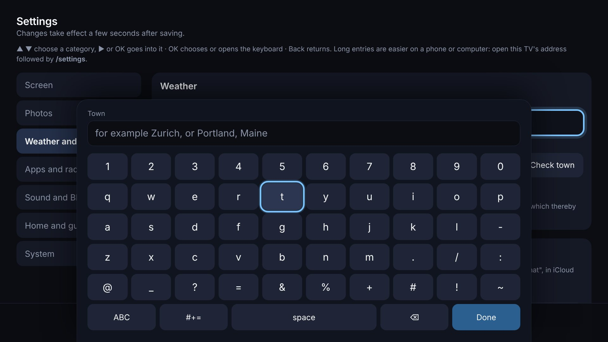

## Settings

Weather, background photos, the calendar, night hours and apps are set up on
the settings page.

- **On the TV:** choose **Settings** in the app row, or press **S**. The page
  opens on the TV and works with the remote alone: arrows move, OK presses a
  button, opens a list, or opens an on-screen keyboard for text.
- **On a phone or computer:** open `http://<pi-ip>:8080/settings`. Long
  entries such as an address are quicker to type there.

The settings are sorted into categories: Screen, Photos, Weather and
calendar, Apps and radio, Sound and Bluetooth, Home and guests, System. On
the TV they are a bar at the left. ▲ ▼ move along it and show each category
at once; ▶ or OK goes into the one that is shown, and **Back** comes out to
the bar again. **Back** on the bar leaves the settings, offering to save
first. On a phone the bar runs along the top. One **Save** saves everything,
whichever category it was changed in.

What it covers:

- **Weather:** your town and the units. **Check town** shows which place the
  weather service found before you save.
- **Background photos:** where photos come from, the connection to Synology
  Photos with a **Test connection** button, the picture quality, how long
  each photo stays, whether photos move, and whether two upright photos
  share the screen (see below). After saving, **Choose folders and albums**
  takes you to the picker.
- **Calendar:** links of the calendars whose next events the TV shows, with
  a **Check link** button.
- **Smart home:** the connection to Home Assistant and which of its devices
  appear as tiles in the app row.
- **Radio:** internet radio stations for the app row, found by name.
- **Screen:** the language, where the clock sits and how large it is, and
  what the dashboard shows when it starts.
- **Night:** hours in which the TV shows only a dim clock on black. Any button
  brings the dashboard back for a minute.
- **Apps:** the app row. Websites have a **size** next to them: 150% or 200%
  makes Netflix, Plex or Synology Photos readable on a 4K screen.
- **Apps, adding:** Add from a list of ready-made apps (YouTube, Netflix,
  Synology Photos, Plex, Moonlight, Kodi, Steam Link), any program installed
  on the Pi, or any website by address. Reorder them, and remove them.

**Programs installed on the Pi** are the ones in the Pi's application menu.
Choose **A program installed on the Pi…** under Add, pick it, and save; a
program installed later appears in that list the next time you open the page.
It gets its own icon and starts the way it does from the menu, as a window on
top of the dashboard. A few things to know:

- Most desktop programs are made for a mouse and keyboard. The TV remote sends
  them arrows, Enter and Esc; for the rest use a mouse or the phone's touchpad.
- Holding **Back** closes the program and returns to the dashboard, as for
  every app.
- A program that only hands over to a copy that is already open (some file
  managers and browsers do) is reported as "closed right after starting",
  although its window opens. PiDash then cannot close it for you.
- Text programs that need a terminal window are not offered.
- If you uninstall a program, its tile disappears; the other settings stay.

The settings page can be opened by anyone on your home network, so it only
lets them pick a program by name. The command always comes from the menu entry
on the Pi itself. A program that needs its own command or options still goes
into `config.toml`.

- **Lock:** a PIN without which settings can be looked at but not changed.
- **Backup:** one file with everything set up here, to save or load from a
  computer.
- **Updates:** which version runs, whether a newer one exists, a button to
  install it, and a switch to have that done automatically at night.

Press **Save**. PiDash restarts itself to apply the changes, which takes a few
seconds, and the TV reloads.

How it fits with `config.toml`:

- What you save is stored in `~/.config/pidash/settings.json`, next to
  `config.toml`, and takes precedence over the same sections there. The page
  never rewrites `config.toml`. Delete `settings.json` to return to exactly
  what `config.toml` says.
- The page can add programs only from its ready-made list. A program with your
  own command still has to be written into `config.toml`; it then appears on
  the page to reorder or remove. This is deliberate: the page is reachable from
  your home network and must not be a way to run commands on the Pi.
- The NAS password is never sent back to the page, and `settings.json` is
  readable by your user only.
- If a PIN is set under `[remote]`, saving and the connection test ask for it.
- Everything else, such as the TV schedule, keys and the phone's mouse mode,
  stays in `config.toml`.

The sections below describe the same settings as they appear in `config.toml`.

## Lock

With a PIN set under **Lock**, the settings can still be opened and looked
at, but saving, installing an update and backups ask for the PIN. On the TV
it is typed on a number pad with the remote, and the TV does not remember it.
If you forget it, remove the `lock` entry from
`~/.config/pidash/settings.json` on the Pi and restart PiDash.

## Backup

**Save a backup file** on the settings page, opened on a computer or phone,
downloads one file with everything set up there, the chosen photo folders
and the hidden photos. **Load a backup file** puts it back, on this Pi or
another one. The file contains the passwords and links stored on the Pi, so
keep it to yourself.

Because of what it holds, not every device on the network can have it:
with the [lock](#lock) set, saving a backup asks for the PIN. Without one,
the TV shows a six-digit code for a couple of minutes, to type on the
computer or phone. That way only someone who can see the TV gets the file.
The code works once, and after five wrong ones there is a pause before the
next. Settings opened on the TV itself save no files, so they need no code.

## Wi-Fi for visitors

Under **Wi-Fi for visitors** in the settings, enter the name and password of
the network guests may use. The app row then has a **Guest Wi-Fi** tile: it
fills the screen with a code that a phone's camera reads to join the network,
and shows name and password in letters for anyone who prefers to type. Any
button closes it.

The password is stored on the Pi like the others and shown to whoever opens
that tile, which is its purpose. Use a guest network rather than your own.
