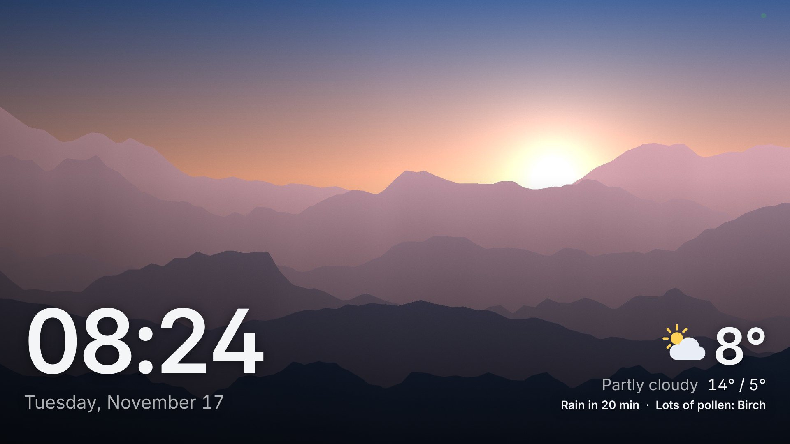

## Using it

| To… | Do this |
|-----|---------|
| Show the dashboard on the TV | Open **PiDash** from the desktop menu, tap **Show on TV** on the phone remote, or run `systemctl --user start pidash-kiosk` |
| See every control | Press **H** or **F1**, or click **Help** on the control bar |
| See the full forecast | Press **OK**, then **OK** again on the **Weather** tile. **Back** closes it |
| Choose the background photos | Open `http://<pi-ip>:8080/photos`, or tap **Background photos** on the phone remote |
| Flip through photos | ◀ ▶ on the dashboard. Play/pause holds the current photo; a small "Photo held" mark shows while it is held |
| Change the volume of headphones or a speaker | Channel up and down on the remote, while the sound goes to them. See [Sound](Music-and-sound#sound) |
| Get help with a problem | **Status** in the app row, then **OK**: saves a file to send along. See [Status page](Performance-and-status#status-page) |
| Do something with the photo on screen | ▲ opens a small bar: favourite, where it was taken, more from its album, hide it. See [The photo's bar](Photos#the-photos-bar) |
| Show more, or only the photo | ▼ steps through: as set, everything, only the photo. See [Language and layout](#language-and-layout) |
| Change settings | Choose **Settings** in the app row, press **S**, or open `http://<pi-ip>:8080/settings` on your phone. See [Settings](Settings#settings) |
| Launch an app | Press **OK** on the dashboard to open the app row, choose with ◀ ▶ and press OK. The row opens on the app you used last. Or tap the app on the phone remote |
| Move an app in the app row, remove it, or hide a tile | Select it and press ▲. See [What ▲ does on a tile](#what--does-on-a-tile) |
| Watch a film or a home video | **Videos** in the app row. See [Videos](Games-and-videos#videos) |
| See where your photos were taken | **Places** in the app row. See [Places](Photos#places) |
| Look at a journey again | **Trips** in the app row. See [Trips](Photos#trips) |
| Play a quiz with your photos | **Photo quiz** in the app row. See [Photo quiz](Photos#photo-quiz) |
| See paintings instead of photos for a while | ▲, then **Art instead of photos**. See [Art mode](Photos#art-mode) |
| See where it is raining | The forecast, then ▶. See [Rain radar](Weather-calendar-and-departures#rain-radar) |
| Switch the TV to the games console or another device | Its tile in the app row. See [Other devices on the TV](TV-and-remote#other-devices-on-the-tv) |
| Let a visitor onto the Wi-Fi | **Guest Wi-Fi** in the app row. See [Wi-Fi for visitors](Settings#wi-fi-for-visitors) |
| Start a game on your PC, or one of RetroArch's | **Games** in the app row, then its cover. See [Games](Games-and-videos#games) |
| Mark a photo as a favourite | ▲, then **OK** on the star. See [Favourites](Photos#favourites) |
| See where and when a photo was taken | ▲, then **About this photo**. See [About this photo](Photos#about-this-photo) |
| Restart or shut down the Pi | **Power** in the app row. See [Restart and shut down](Performance-and-status#restart-and-shut-down) |
| Change the TV's volume from a controller | Hold its logo button and press up or down |
| See how PiDash is doing | Choose **Status** in the app row. See [Status page](Performance-and-status#status-page) |
| Choose where the sound comes out, and how loud | **Settings** in the app row, then **Sound**. See [Sound](Music-and-sound#sound) |
| Connect or disconnect headphones or a controller | ▲, then **Bluetooth** at the end of the bar; or the **Bluetooth** tile in the app row |
| Pair a Bluetooth controller, headphones or a speaker | **Settings** in the app row, then **Bluetooth**. See [Bluetooth](Music-and-sound#bluetooth) |
| Use a game controller | Plug it in or pair it. Switching it on also switches the TV on. See [Game controller](TV-and-remote#game-controller) |
| Get back from an app | **Hold Back for 2 seconds** on the TV remote, hold **Esc** on a keyboard, or tap **Back to dashboard** on the phone remote |
| Use the phone as mouse and keyboard | Switch it on once (see [Phone as mouse and keyboard](TV-and-remote#phone-as-mouse-and-keyboard)), then use the touchpad on the phone remote |
| Switch the TV on or off | **TV on** / **TV off** on the phone remote, or a daily schedule (see [TV power schedule](TV-and-remote#tv-power-schedule)) |
| Go back to the desktop | **Hold Back for 2 seconds** on the TV remote, press **Alt+F4** or **F10** on a keyboard, or tap **Exit to desktop** on the phone remote |
| Use the phone remote | Open `http://<pi-ip>:8080/remote` on any device on your network |
| Change settings | Edit `~/.config/pidash/config.toml`, then `systemctl --user restart pidash` |
| Find out why something does not work | `bash ~/.local/share/pidash/doctor.sh`, see [Troubleshooting](Troubleshooting) |
| Uninstall | `bash ~/.local/share/pidash/uninstall.sh` (add `--purge` to delete settings too) |

The screen stays awake while the dashboard is showing; your normal screen
blanking applies again once you exit. The layout scales to whatever resolution
the desktop uses. For the smoothest result on a 4K TV, set the desktop to
1920x1080 in *Preferences → Screen Configuration*.

## Keyboard and mouse

The dashboard works with a TV remote, a keyboard, a mouse, an air mouse, a touch
screen, or the phone. Press **H** or **F1** at any time for an overview on the
TV; it lists the keys as they are currently set.

**Keyboard**

| Key | Does |
|-----|------|
| Enter, Space | Open the app row, choose a tile |
| Esc, Backspace | Close, go back. Hold 2 seconds to exit to the desktop |
| ← → | Previous / next photo, or move along the app row |
| Tab, Shift+Tab | Move along the app row |
| ↑ | What can be done with the photo on screen |
| ↓ | Show more, or only the photo |
| A | App row |
| W | Weather details |
| P | Hold or resume the slideshow |
| 1 – 9 | Choose a tile in the app row |
| H, F1, / | Show all controls |
| F10 | Return to the desktop |

Shortcuts of the desktop itself, such as Alt+F4 and anything with Ctrl, are
left alone. To add or change keys, see `[input.keys]` in the settings: your
entries are added to the built-in ones, and `"none"` switches one off.

**Mouse**

The pointer is hidden until the mouse moves. Then a control bar appears at the
top with previous, pause and next for the photos, and Apps, Weather, Help and
Desktop. Both fade away again after a few seconds.

- **Click** anywhere to open or close the app row; click a tile to start it.
- **Right-click** goes back.
- **The wheel** steps through photos, or along the app row while it is open.
- **Click the weather** in the corner for the details; click again to close.

With the [phone as mouse](TV-and-remote#phone-as-mouse-and-keyboard), the same works from the
sofa.

## What ▲ does on a tile

▲ on a tile in the app row opens a short list of what can be done with it:

- **An app**: *Move* (carry it with ◀ ▶, put it down with **OK**; **Back**
  leaves it where it was), *Remove from the app row* (nothing is
  uninstalled; it can be added again under Settings, Apps), and *Rename or
  change it*, which opens the settings.
- **A tile of PiDash's own** (Weather, Bluetooth, Sound, Sleep timer, Videos,
  Places, Trips, Photo quiz, Guest Wi-Fi, Status, Desktop, Power): *Hide
  this tile*. It comes
  back under Settings, Apps and radio, *Other tiles in the app row*, where
  every tile has a box to tick (`hidden_tiles` under `[display]`).

**Settings** cannot be hidden. With a settings PIN set, removing and hiding
need the PIN, and so are done on the settings page.

## Language and layout

Under **Screen** on the settings page:

- **Language:** English, German, French or Italian, for the dashboard, the
  settings and the dates. Messages that come from the Pi itself, such as "the
  NAS cannot be reached", stay in English.
- **Clock position and size:** any of the four corners, in three sizes. The
  calendar takes the bottom corner the clock leaves free.
- **Clock style:** bold numbers, slim numbers, or a clock with hands. The
  hands move once a minute, like the numbers.
- **Under a photo:** nothing, or its caption: album, place and date.
- **Weather on the dashboard:** none, the temperature and conditions, or also
  the place, what it feels like and the chance of rain. (Rain about to start
  and bad air are said in every setting but "none".)
- **Keep it like this:** normally ▼ on the remote steps on from what is set
  to everything, to only the photo, and back. With this ticked, ▼ does
  nothing and the dashboard always looks as set. In `config.toml` these are
  `caption = "on"`, `weather_detail = "short"` and `lock_view = true`.
- **Small sounds when using the remote:** a tick when the highlight moves, two
  rising notes when something is chosen, a low note where there is nowhere
  further to go. They are quiet, made by the page itself, and come out of
  whatever [sound output](Music-and-sound#sound) is chosen. `sounds = false` under
  `[display]` does the same as the switch.

**Holding a direction** on the remote or a controller keeps the highlight
moving, along the app row and through the settings pages. It starts after
two thirds of a second: some TVs never say that a button was let go, and
anything quicker would turn each press on those into two. On the dashboard
itself a held direction does nothing, so photos are not raced through.

The translations live in one table, `scripts/translations.py`; running it
writes the language files.

## Night mode

Between two times of day, set on the settings page under **Night**, the TV
shows only a dim clock on black: no photos, no weather, no calendar. Any
button brings the dashboard back for a minute; the press that wakes it does
nothing else. This is separate from the [TV power schedule](TV-and-remote#tv-power-schedule),
which switches the TV itself off.

Either time can follow the sun instead of the clock: night mode can begin at
sunset, or one to three hours after it, and end at sunrise or an hour either
side. The times are those of the town set under [Weather](Weather-calendar-and-departures#weather), in its
own time zone, and move with the seasons; without the weather set up, a night
that follows the sun does not begin. In `config.toml` any distance in minutes
works:

```toml
[display]
night_start = "sunset+90"   # or a time of day, such as "22:30"
night_end = "sunrise-30"
```

**Dimming in the evening.** Under **Screen**, *Dim the picture in the evening*
lays a dark sheet over the whole dashboard, a little or a lot. It comes
gradually over the hour after sunset and is gone again at sunrise, so the TV
is less of a lamp in a dark room. Without the weather set up it runs from
eight in the evening to seven in the morning. (`evening_dim = "off"`,
`"light"` or `"strong"`.)

## Background without photos

While no photo is on screen (no photo source, nothing chosen yet, or the NAS is
away), the background shows broad ribbons of colour that wind slowly across
the screen.

- **They react to you.** Left and right send them flowing that way, up and
  down make them sway, OK sends a swell through them, and opening the app row
  lifts them along with the clock. With a mouse they lean towards the pointer.
  A few seconds later they are back to their slow drift.
- **They take the colours of the selected app.** With the app row open, the
  ribbons turn to the colours of the selected icon: red for YouTube, the
  icon's own mix for anything else.
- **They can stand still.** Under **Screen** on the settings page,
  **Background without photos** can be set to a still picture. It keeps its
  look and still takes the colours of the selected app, but is painted once
  instead of continuously, which keeps the Pi cooler.
- **They are sharp without costing much.** The ribbons are drawn at half the
  screen's resolution: 1080p on a 4K screen, which keeps their edges crisp at
  a quarter of the work. If the Pi cannot keep up, the picture steps down to
  a coarser size by itself and looks softer. Drawing stops while a photo or
  an app covers it. If the system is set to reduce motion, the ribbons stand
  still and only change colour.

## What is new

After an update the TV says once, in a few lines, what the new version
brought. Any button closes it.
