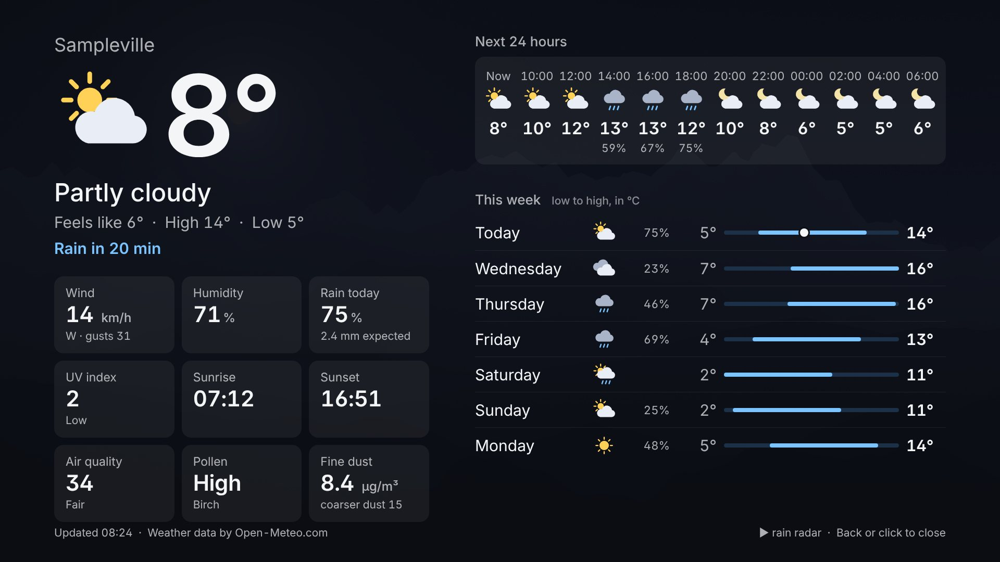

## Weather

Set your town in `~/.config/pidash/config.toml` and restart the backend:

```toml
[weather]
location = "Zurich"
```

The current temperature, conditions and today's high and low then appear in the
bottom right corner of the screen. The place name, the "feels like"
temperature and the chance of rain can be added to it, or the weather taken
off the dashboard altogether: see *Weather on the dashboard* under
[Language and layout](Using-the-dashboard#language-and-layout).

For more, press **OK** to open the app row and **OK** again on the **Weather**
tile, which is first in the row. The detail view shows:

- the current temperature and conditions, with what it feels like
- wind with direction and gusts, humidity, chance and amount of rain today,
  UV index, sunrise and sunset
- the air quality as a number and a word, the pollen that is flying, and the
  fine dust (see below)
- the next 24 hours in two-hour steps, with the chance of rain where it matters
- the next seven days, each as a bar from its low to its high on one shared
  scale, so warm and cold days are easy to compare. The dot on today's bar is
  the temperature right now.

**Back** or **OK** closes it. With a mouse, clicking the weather in the corner
opens it too.

**Rain soon.** When rain or snow is about to begin, the corner of the
dashboard says so: "Rain in 20 min". While it rains it says when it stops.
This looks two hours ahead, in quarters of an hour, so read it as "about".

**Air and pollen.** The detail view has the air quality (the European index,
or the US one with `units = "imperial"`), the strongest pollen and the fine
dust (PM2.5, with PM10 as "coarser dust"). On the dashboard itself they appear
only when they matter: air that is poor or worse, or a lot of some pollen.
Pollen is known for Europe only, and only in season. Where the weather service
has no air data, the three tiles are simply not there.

Options:

```toml
[weather]
location = "Portland, Maine"   # add a region or country for ambiguous names
# latitude = 43.66             # or give exact coordinates instead
# longitude = -70.26
# name = "Home"                # label on the TV
units = "metric"               # or "imperial" for °F, mph and inches
interval = "15m"               # how often the forecast is refreshed
```

### Rain radar

On the forecast, ▶ opens the rain radar: a map of your region with the rain
of the last hour on it, as seven pictures ten minutes apart that run one
after the other up to now, and on through the hour to come. It opens on now.
The time of the picture on screen is at the top left; the pin is the place
the weather is for. The line of marks at the bottom left is the film: what
was, now (the tall mark), and what is expected (the rings).

**The hour to come is an estimate that PiDash makes itself.** Radar services
no longer give pictures of the future away. PiDash looks at how the rain
around you moved over the last twenty minutes and moves the newest picture
on by as much, ten minutes at a time: what a person does who watches a radar
film. That is good for a front crossing the country, and for telling whether
the shower over there arrives before the walk is over. It knows nothing of
rain that forms or fades where it is, as summer showers do. These pictures
are drawn paler, and their time is marked "expected".

| Button | Does |
|--------|------|
| ◀ ▶ | An earlier or a later picture; the pictures stop running |
| **OK**, play/pause | Run again, or hold |
| ▲ ▼ | Closer or further away |
| **Back** | Back to the forecast |

The pictures come from [RainViewer](https://www.rainviewer.com), which
gathers the weather services' radars; where no radar reaches, the map stays
empty. The Pi fetches them, and RainViewer thereby learns the region you
look at, not more. It goes no closer than a region, which is as far as
RainViewer hands its pictures out. Settings, Weather has the switch
(`radar = false` under `[weather]`).

Weather data comes from [Open-Meteo](https://open-meteo.com), which is free for
personal use and needs no account. If the internet is down, the last forecast
stays on screen, and the detail view says when it was last updated. Times such
as sunrise are shown in the local time of the place you configured.

## Calendar

PiDash shows your next events at the bottom right, grouped under Today,
Tomorrow and the days after. It reads calendars through their link, which
every common calendar offers:

| Calendar | Where the link is |
|---|---|
| Google Calendar | Settings of the calendar, "Secret address in iCal format" |
| iCloud | Share the calendar as a public calendar and copy its link |
| Outlook.com | Settings, Calendar, Shared calendars, publish, the ICS link |
| Synology Calendar | Publish the calendar and copy its link |

Add the link on the settings page under **Calendar**; **Check link** tells you
how many events it finds. Several calendars can be combined. Repeating
events, single moved or cancelled dates and all-day events are understood.
The list is read again every 15 minutes.

Whoever has such a link can read the calendar. PiDash stores it on the Pi in a
file only your user can read, and the settings page never shows it again,
only the name of the server it leads to.

## Departures

The next trams, buses and trains from a stop near you, beside the clock:
the line, where it goes, and in how many minutes, with delays (`+2`) and
counting down by itself. Under **Settings, Weather and calendar,
Departures**, enter the stop's name and press **Look it up**; what is saved
is the name the timetable has for it. **Minutes it takes to get there**
leaves out what you could not catch any more. Four departures are shown at
a time; beyond the hour, the time of day takes the place of the minutes.

The timetable is that of [transport.opendata.ch](https://transport.opendata.ch),
the open service for Swiss public transport, which needs no account. It
knows every stop in Switzerland and none elsewhere, so this is for
Switzerland. The Pi asks it every minute and a half, and it thereby learns
which stop you look at, not more. If it cannot be reached, the last answer
is used for as long as it has anything in it that has not left.

In `config.toml`:

```toml
[departures]
stop = "Zürich, Bellevue"   # or the stop's number in the timetable
walk = 3                    # minutes to get there
```

## Smart home

With Home Assistant, lights, plugs, covers, scenes, scripts and sensor values
can sit in the app row as tiles. **OK** switches a light or plug, opens or
closes a cover, or runs a scene or script; a tile for a sensor shows its
value.

1. In Home Assistant, open your profile, then **Security**, and create a
   **long-lived access token**.
2. On the settings page under **Smart home**, enter Home Assistant's address
   and the token, and press **Connect and list devices**.
3. Pick the devices you want from the list, add them, and save.

Locks and alarm panels are never offered: a remote lying on the sofa should
not open the door. Only the tiles you put on the app row can be switched
from PiDash. The token stays on the Pi and is never shown again.
